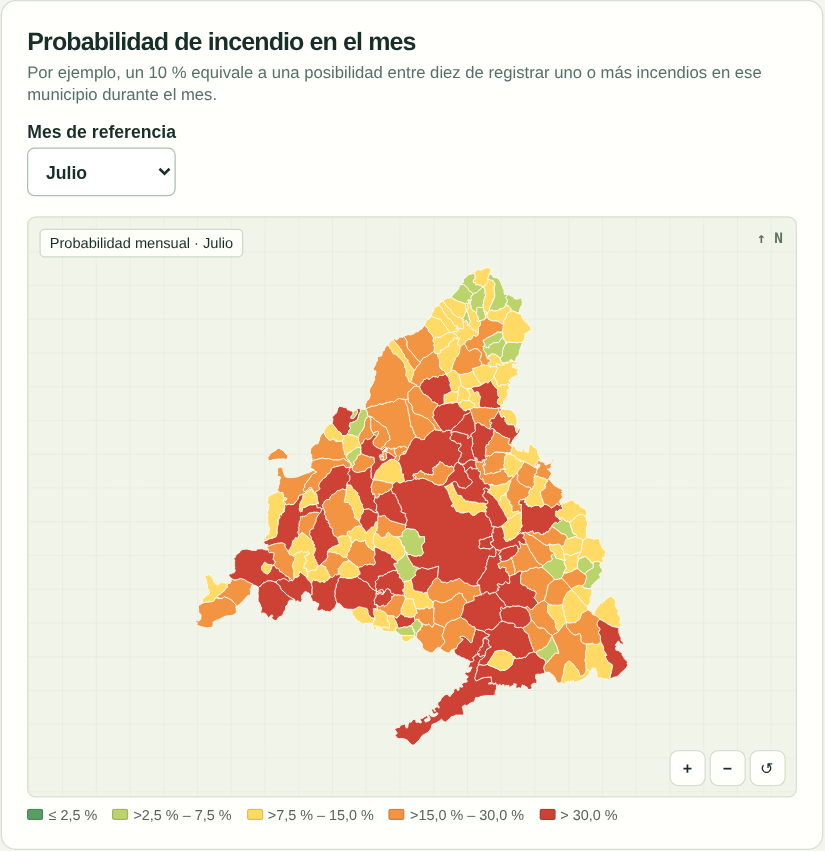
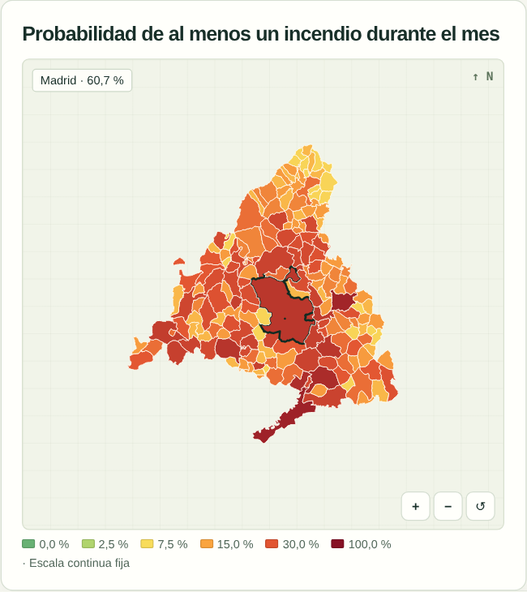
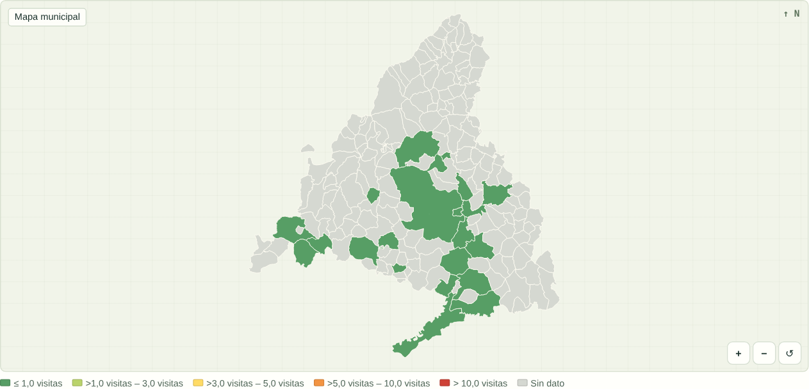

# FireRisk Madrid
**Si un equipo dispone de 20 visitas preventivas para 179 municipios, ¿por dónde empieza?**

FireRisk ayuda a un ayuntamiento o a un equipo ambiental a elegir qué municipios estudiar primero, explicar esa elección y compartir un reparto de visitas. Reúne en una sola web datos abiertos de la Comunidad de Madrid, registros de incendios y escenarios climáticos.

**[Ver la presentación en PDF](FireRisk-DATAMAD-PRESENTACIÓN.pdf)** · [Descargar el PowerPoint](FireRisk-DATAMAD-PRESENTACIÓN.pptx)

## Para qué lo usaría un equipo de prevención

En una reunión de campaña, el responsable puede comparar municipios, explicar por qué propone revisar unos antes que otros y entregar una tabla de visitas que sus compañeros puedan revisar. En un piloto se podría medir el tiempo de preparación frente al método habitual, la proporción de visitas realizadas y las incidencias detectadas en ellas. El proyecto todavía no ha medido esos resultados sobre el terreno.

## Del mapa a una decisión

| Pregunta | Qué ofrece FireRisk |
|---|---|
| ¿Dónde y cuándo se concentran los incendios? | Un observatorio de 179 municipios y 5.208 partes de 2006–2023, incluidos los conatos. La ficha municipal permite comparar el historial con la estimación mensual. |
| ¿Qué puede cambiar entre campañas? | Un mapa 2027–2030 que combina municipio, mes y temperatura bajo dos simulaciones climáticas. |
| ¿Qué tiempo se espera esta semana? | Siete días de previsión municipal de temperatura, lluvia y viento. La web muestra la fecha de descarga. |
| ¿Cómo distribuimos las visitas? | Un simulador reparte el número disponible entre los municipios seleccionados según la probabilidad mensual histórica. El resultado se descarga en CSV para su revisión. |

## Una campaña futura, con la incertidumbre a la vista

Para Madrid capital, la estimación central de registrar **al menos un incendio durante julio** pasa del **60,7 % en 2027 al 60,1 % en 2029**. El cambio refleja temperaturas simuladas. La escala de colores permanece fija para que los años sean comparables.

## Aplicación práctica

El equipo elige el mes, el número de municipios y las visitas disponibles. Obtiene un reparto que suma exactamente su capacidad y puede revisarlo con información local. El beneficio que ofrece hoy es una planificación trazable. Cuantificar cuánto tiempo ahorra o cuántos incendios ayuda a evitar requeriría probarlo con una administración.

## De dónde salen las cifras

La cartografía, las series regionales de incendios y la meteorología proceden de datos abiertos de la Comunidad de Madrid. Los partes EGIF permiten evaluar qué municipios y meses registraron incendios. Open-Meteo aporta previsiones semanales y acceso a simulaciones CMIP6.

Para el modelo de campañas se contrastaron 1.052 partes de 2020–2023. En la prueba retrospectiva de 2023, añadir temperatura observada redujo ligeramente el error Brier, de 0,0700 a 0,0694. La capacidad de anticipar campañas futuras depende también de las simulaciones climáticas. [Fuentes y atribuciones](docs/FUENTES_DE_DATOS.md) · [Cómo se evaluó el modelo](docs/PREDICCION_CAMPANAS.md) · [Limitaciones](docs/LIMITACIONES.md)

## Abrir la demo

Descomprime la carpeta completa. En Windows haz doble clic en **start_windows.bat**. Requiere Python 3.10 o posterior. El iniciador prepara el entorno local y abre la web. En macOS o Linux usa `sh start_mac_linux.sh` o `python3 app.py`. La dirección local es http://127.0.0.1:8501 . Cierra la ventana de la terminal para salir. La consulta utiliza la biblioteca estándar de Python. Solo la actualización del tiempo requiere conexión.

