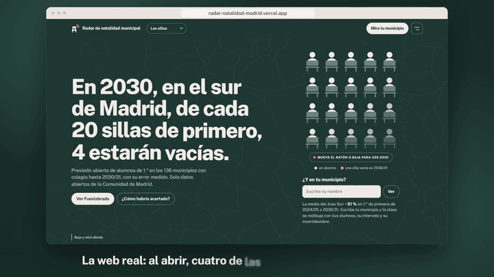

# 2 · Radar de natalidad municipal

**Antonio González Fernández** (individual) · DATAMAD 2026 · **Proyecto n.º 2** · **[Web en directo: radar-natalidad-madrid.vercel.app](https://radar-natalidad-madrid.vercel.app)**

> [!TIP]
> **¿5 minutos? Empieza aquí:**
>
> **1.** [Presentación oficial, 4 diapositivas](1_PRESENTACION_OFICIAL_Radar_natalidad.pdf) · **2.** [Vídeo de la demo, 1 min 48 s (se ve en el navegador)](https://radar-natalidad-madrid.vercel.app/video/demo_radar_natalidad.mp4) · **3.** [La web en directo](https://radar-natalidad-madrid.vercel.app) (prueba [tu municipio](https://radar-natalidad-madrid.vercel.app/?m=Fuenlabrada) y el simulador [«¿Y si…?»](https://radar-natalidad-madrid.vercel.app/?m=Fuenlabrada&si=10)) · **4.** [Dossier de 11 páginas](3_DOSSIER_Radar_natalidad.pdf) · En 1 minuto: [la ficha](4_FICHA_RADAR_NATALIDAD.pdf)

## Resumen

### En 2030, en el sur de Madrid, de cada 20 sillas de primero, 4 estarán vacías.

<table>
<tr>
<td width="40%" valign="top"><a href="https://radar-natalidad-madrid.vercel.app/video/demo_radar_natalidad.mp4"></a><br><b>▶ Vídeo de la demo (1 min 48 s):</b> pulsa la imagen y se ve en el navegador; también está en esta carpeta: <a href="2_VIDEO_demo_radar_natalidad.mp4">2_VIDEO_demo_radar_natalidad.mp4</a></td>
<td valign="top"><b>Qué es:</b> una previsión abierta de cuántos niños empezarán 1.º de primaria en cada uno de los 136 municipios con colegio de la Comunidad de Madrid, hasta el curso 2030/31, con su margen de error y solo con datos abiertos de la Comunidad.<br><br><b>Para quién:</b> la Consejería de Educación, que decide aulas y docentes con años de antelación, y los ayuntamientos y las familias, que verían la misma cifra.<br><br><b>La cifra que lo prueba:</b> en cursos ya cerrados falla un <b>4,3 %</b>, frente al <b>16,1 %</b> de suponer que nada cambia (error mediano a cinco cursos vista, en los 36 municipios grandes).</td>
</tr>
</table>

**Presentación oficial (4 diapositivas): [1_PRESENTACION_OFICIAL_Radar_natalidad.pdf](1_PRESENTACION_OFICIAL_Radar_natalidad.pdf) · [.pptx](1_PRESENTACION_OFICIAL_Radar_natalidad.pptx)** · Vídeo (1 min 48 s): [verlo en el navegador](https://radar-natalidad-madrid.vercel.app/video/demo_radar_natalidad.mp4) o [2_VIDEO_demo_radar_natalidad.mp4](2_VIDEO_demo_radar_natalidad.mp4) · Dossier (11 páginas, se entiende solo): [3_DOSSIER_Radar_natalidad.pdf](3_DOSSIER_Radar_natalidad.pdf) · Ficha (una página): [4_FICHA_RADAR_NATALIDAD.pdf](4_FICHA_RADAR_NATALIDAD.pdf)

| **4,3 %** frente a 16,1 % | **78,2 %** | **0,9 %** | **0 €** |
|:---:|:---:|:---:|:---:|
| error del radar frente a «nada cambia» (36 municipios grandes, a cinco cursos) | el intervalo del 80 % acertó casi 8 de cada 10 veces | error en 2025/26, total regional, sin ver el dato | al año: web y API estáticas, código MIT |

| Criterio (puntos) | La prueba, en una línea | Págs. del dossier |
|---|---|---|
| Uso y aprovechamiento de datos abiertos de la Comunidad de Madrid (25) | Solo datos abiertos de la Comunidad: cruza 7 recursos de 6 conjuntos del catálogo (nacimientos, matrícula, censo, padrón y límites), armonizados por código INE, cada uno con su URL, su fecha y su huella SHA-256. Y devuelve al ecosistema un conjunto nuevo: 816 previsiones por municipio y curso, en API abierta y en Smart Data Models | 4 y 9 |
| Originalidad e innovación (20) | No adivina nacimientos: cuenta niños que ya han nacido, municipio a municipio, y publica cuánto falla: un intervalo del 80 % que acertó el 78,2 % de las veces y un diagnóstico espacial de sus errores. En el catálogo no hay ninguna previsión municipal. Un simulador «¿Y si…?» en cada ficha. Y un asistente de IA especializado, sin reentrenar, evaluado: 10/10 en una prueba pequeña ([7_ASISTENTE_IA_evaluado.md](7_ASISTENTE_IA_evaluado.md)) | 2, 4 y 10 |
| Potencial impacto económico, social, tecnológico o medioambiental (25) | Todos saben que habrá menos alumnos (EFE, 29-abr-2026), pero las aulas se quitan colegio a colegio y «sin criterios claros» (El País, 22-sep-2023). El radar da la misma cifra pública, años antes, a la Consejería (unidades y docentes), a los ayuntamientos (colegios y suelo) y a las familias: unas 340 aulas de 1.º menos en la región hasta 2030/31 | 2, 3 y 10 |
| Viabilidad y aplicabilidad de la solución (15) | Ya está en producción (web y API) y cuesta 0 € al año. Probado en cursos ya cerrados: 4,3 % de error frente al 16,1 % de suponer que nada cambia; curso 2025/26, total regional, sin ver el dato: 0,9 %. Aún sin usuarios ni clientes: hoy (26-nov) he propuesto un piloto gratuito a la Concejalía de Educación de Fuenlabrada | 5 a 8 y 10 |
| Uso de tecnologías abiertas, código abierto y reproducibilidad (10) | Código MIT ([GitHub](https://github.com/antonmareo10/datamad-radar-natalidad); versión entregada: [etiqueta `datamad-2026-entrega`](https://github.com/antonmareo10/datamad-radar-natalidad/tree/datamad-2026-entrega), commit `52aac25`); web y API estáticas, sin claves ni servidor; servidor MCP; Smart Data Models (FIWARE). Todas las cifras se rehacen con una orden: `python -m radar todo`, y 69 pruebas automáticas las vigilan (`pytest`) | 10 y 11 |
| Calidad y claridad de la presentación (5) | Cuatro diapositivas, un vídeo de 1 min 48 s que se entiende sin sonido, un dossier de 11 páginas y una ficha de una página | arriba |

## Por qué

**Nacen un tercio menos de niños que en 2008, y las aulas de 2030 se deciden ahora.**

1. **Todos saben que habrá menos alumnos.** «La baja natalidad vaciará aulas de Primaria y Secundaria: 600.000 alumnos menos en 2035» ([EFE, 29-abr-2026](https://efe.com/espana/2026-04-29/baja-natalidad-aulas-primaria-secundaria-600-000-alumnos-menos-2035/), sobre un informe de M. Requena, de la UNED, para la Fundación Ramón Areces y la Fundación Europea Sociedad y Educación). Es una cifra nacional y por comunidades, no por municipio.
2. **Pero las aulas se quitan colegio a colegio, y ahí no hay una cifra a la vista.** En Móstoles, sindicatos y AMPAS criticaban que se eliminan aulas «sin criterios claros» ([El País, 22-sep-2023](https://elpais.com/espana/madrid/2023-09-22/las-consecuencias-de-cerrar-aulas-en-un-colegio-de-mostoles-dejar-al-nino-en-casa-o-45-minutos-en-autobus-cada-dia.html)).
3. **El criterio existe y es público: los niños de 2030 ya han nacido.** En la Comunidad de Madrid nacieron 50.770 en 2024, frente a 78.741 en 2008 (−35,5 %), y quien empiece 1.º en 2030 está en esa cuenta. Frente a 2024/25, cuando empezaron los nacidos en 2018, 1.º baja un 11,6 % en la región y un 21,0 % en el Área Sur.
4. **Faltaba convertirlo en una cifra por municipio.** En el catálogo de datos abiertos no hay ninguna previsión municipal. El radar la da, con su margen de error y probada con el pasado. No dice qué colegio pierde el aula: da el dato de partida para discutirlo.
5. **Así la Consejería, el ayuntamiento y las familias discuten la misma cifra pública, años antes y no en septiembre.**


## Qué quería resolver

**Decir a cada ayuntamiento cuántos niños empezarán 1.º de primaria en su municipio cada curso hasta 2030/31, con su margen de error.** Una cifra sola no basta para abrir o cerrar un aula: hace falta saber cuánto puede fallar.

## Qué he hecho

**Los niños de 2030 ya han nacido: basta contarlos y corregir por municipio.** El método, en tres pasos:

| 1. Nacidos en 2024 | 2. Factor del municipio | 3. Alumnos de 1.º en 2030/31 |
|---|---|---|
| dato publicado del catálogo | alumnos que escolariza el municipio por cada niño nacido en él, medido en su matrícula | con su intervalo del 80 % |
| **1.132** en Fuenlabrada | **× 1,016** | **≈ 1.150** (entre 1.075 y 1.277) |

**Cómo se calcula.** El factor son los alumnos de infantil (3 a 5 años) del municipio divididos entre los niños nacidos en él que tienen esa edad, y multiplicados por una corrección regional, igual para todos, que pasa de infantil a 1.º. El intervalo del 80 % no sale de una fórmula: son los percentiles 10 y 90 de los errores reales del método en cursos ya cerrados, por tamaño de municipio y antelación; por eso un pueblo pequeño recibe un intervalo ancho. Fórmulas: [6_ANEXO_TECNICO_Radar_natalidad.pdf](6_ANEXO_TECNICO_Radar_natalidad.pdf), p. 2.

**Lo que se puede usar hoy:**

- **[Web](https://radar-natalidad-madrid.vercel.app)**: mapa de los municipios y una ficha por municipio con la serie, la previsión, su intervalo y cómo habría acertado el método en cursos pasados.
- **Simulador «¿Y si llegan más (o menos) familias con niños?»** en cada ficha ([ejemplo: Fuenlabrada, +10 %](https://radar-natalidad-madrid.vercel.app/?m=Fuenlabrada&si=10)): mueve el factor del municipio entre −20 % y +20 % y recalcula los alumnos y las aulas de 2030/31. Es una simulación, no la previsión: en 0 coincide con ella, y ni la previsión ni su intervalo cambian.
- **[API abierta](https://radar-natalidad-madrid.vercel.app/api/v1/)**: ficheros JSON estáticos, sin claves ni servidor (por ejemplo, [Fuenlabrada](https://radar-natalidad-madrid.vercel.app/api/v1/municipios/28058.json)).
- **[Servidor MCP](https://github.com/antonmareo10/datamad-radar-natalidad/tree/master/mcp_server)** de solo lectura: un asistente de IA consulta el radar con cuatro herramientas (buscar un municipio, su previsión, su fiabilidad y los mayores cambios) y responde siempre con el intervalo del 80 %.
- **Asistente especializado, evaluado ([7_ASISTENTE_IA_evaluado.md](7_ASISTENTE_IA_evaluado.md)):** un agente nuevo, con un modelo de IA general y solo con las reglas y la API pública, sin reentrenar, sacó 10/10: 8/8 preguntas de dato con la cifra, el intervalo y la fuente del radar, y 2/2 trampas rechazadas sin inventar. Se puntuó de forma determinista contra la API de producción. Es una prueba pequeña (10 preguntas, un solo modelo): demuestra el método, no que acierte siempre. [Preguntas, puntuador y respuestas](https://github.com/antonmareo10/datamad-radar-natalidad/tree/master/analisis).
- **Smart Data Models**: las 816 previsiones de 1.º, también como entidades NGSI-LD del modelo [`dataModel.SDMX/Observation`](https://github.com/smart-data-models/dataModel.SDMX/tree/master/Observation) (FIWARE), marcadas como previsión (`obsStatus` = `F`) y validadas contra su JSON Schema oficial: [fichero](https://radar-natalidad-madrid.vercel.app/api/v1/sdm/observaciones_1o.json) · [qué modelo y por qué](https://github.com/antonmareo10/datamad-radar-natalidad/blob/master/docs/SMART_DATA_MODELS.md).


## Resultados

**El radar prevé 6.812 alumnos de 1.º menos en la región en 2030/31, unas 340 aulas. Y está probado en cursos ya cerrados: falla un 4,3 % donde suponer que nada cambia falla un 16,1 %.**

Y no es cosa de un curso: los niños que falten en 1.º en 2030 faltarán en 2.º al curso siguiente, en 3.º al otro, y así según suba su promoción (salvo las familias que lleguen o se vayan).


| Qué | Cifra |
|---|---|
| 1.º de primaria en la región, 2030/31 frente a 2024/25 | **6.812 alumnos menos (−11,6 %) ≈ 340 aulas** de 20 alumnos. Intervalo del 80 %: de 1.388 a 12.314 menos |
| Área Sur | **−21,0 %**: 4 de cada 20 sillas |
| Madrid capital | **−5,7 %** |
| Error mediano a cinco cursos, 36 municipios grandes (72 previsiones) | **4,3 %** el radar, frente al **16,1 %** de suponer que nada cambia |
| ¿Acierta su margen de error? | El intervalo del 80 %, calculado sin los errores de su propio curso de partida, contuvo el dato real en el **78,2 %** de los casos: casi 8 de cada 10, cerca del 80 % anunciado |
| Curso 2025/26, sin ver el dato | Total regional: previó 56.969; se publicaron 56.482 (provisional): **0,9 %** de error |


**Cómo se ha probado: el método estándar para evaluar previsiones.**

- **Backtest con origen móvil:** se prevé desde cada curso pasado, solo con lo que se sabía entonces, y se compara con lo que ocurrió después.
- **Comparación con dos referencias ingenuas:** «nada cambia» (los mismos alumnos que en el último curso conocido) y «solo nacidos» (los nacidos tal cual, sin el factor del municipio). El radar gana a las dos en todos los tamaños de municipio y a todas las antelaciones. En los grandes, a cinco cursos, la más exigente es «solo nacidos»: falla un 13,6 %; el radar, un 4,3 %.
- **Cobertura del intervalo del 80 %:** cuántas veces el dato real cayó dentro del margen anunciado (78,2 %).
- **Diagnóstico espacial de los residuos:** los errores con signo del backtest no se agrupan en el mapa (I de Moran = −0,02 a cinco cursos en los 36 municipios grandes, p = 0,98; −0,05 con todos los municipios y horizontes, p = 0,44, n = 132: los que tienen error medido y algún vecino en la muestra; vecindad de reina, 9 999 permutaciones). El tamaño del error sí depende del tamaño del municipio, y por eso los intervalos se calculan por grupo: [mapa](imagenes/06_errores_no_se_agrupan.png) · [script](https://github.com/antonmareo10/datamad-radar-natalidad/tree/master/analisis/moran).

**Lo que hay que saber de estas cifras.** El método se eligió entre varias variantes con estos mismos cursos, así que el 4,3 % es algo optimista; no intervinieron en esa elección ni el dato de 2025/26 ni la cobertura del intervalo. Tabla completa, por tamaño de municipio y antelación: [6_ANEXO_TECNICO_Radar_natalidad.pdf](6_ANEXO_TECNICO_Radar_natalidad.pdf), p. 1.

## Información e informe

**Todo está abierto: se puede probar, leer y rehacer desde cero.**

- **Código de la versión entregada, en esta carpeta:** [8_CODIGO_radar_datamad-2026-entrega.zip](8_CODIGO_radar_datamad-2026-entrega.zip) (etiqueta `datamad-2026-entrega` del repositorio, sin el vídeo; 300 ficheros, MIT).

- **Web:** https://radar-natalidad-madrid.vercel.app
- **Presentación oficial (4 diapositivas):** [1_PRESENTACION_OFICIAL_Radar_natalidad.pdf](1_PRESENTACION_OFICIAL_Radar_natalidad.pdf) · [PowerPoint](1_PRESENTACION_OFICIAL_Radar_natalidad.pptx)
- **Dossier para leer (5 min, 11 páginas):** [3_DOSSIER_Radar_natalidad.pdf](3_DOSSIER_Radar_natalidad.pdf)
- **Ficha de una página:** [4_FICHA_RADAR_NATALIDAD.pdf](4_FICHA_RADAR_NATALIDAD.pdf)
- **Vídeo de la demo (1 min 48 s):** [verlo en el navegador](https://radar-natalidad-madrid.vercel.app/video/demo_radar_natalidad.mp4) o [2_VIDEO_demo_radar_natalidad.mp4](2_VIDEO_demo_radar_natalidad.mp4). Recorre la web: tu municipio, el mapa de 2025 a 2030, la ficha con su margen de error, la prueba en cursos cerrados y una consulta real de un asistente de IA por MCP.
- **Diapositivas del pitch (3 min, para proyectar; 16 páginas):** [5_PITCH_3min_para_proyectar.pdf](5_PITCH_3min_para_proyectar.pdf) · [PowerPoint](5_PITCH_3min_para_proyectar.pptx)
- **Anexo técnico (método, prueba completa, fuentes de cada cifra):** [6_ANEXO_TECNICO_Radar_natalidad.pdf](6_ANEXO_TECNICO_Radar_natalidad.pdf)
- **API abierta:** https://radar-natalidad-madrid.vercel.app/api/v1/
- **Código, con licencia MIT:** https://github.com/antonmareo10/datamad-radar-natalidad
- **Resumen en texto para asistentes de IA:** https://radar-natalidad-madrid.vercel.app/llms.txt

<a href="4_FICHA_RADAR_NATALIDAD.pdf"></a>

<sub>La ficha, en pequeño: púlsala para abrir el PDF.</sub>

## Datos utilizados

**Solo datos abiertos de la Comunidad de Madrid, cada uno con su fecha y su huella.**

> **Sobre estos datos**
>
> - **Fuente:** [Catálogo de Datos Abiertos de la Comunidad de Madrid](https://datos.comunidad.madrid). 7 recursos de 6 conjuntos de datos, todos con licencia CC BY. Nada de fuera de la región.
> - **Qué años cubren:** nacidos por municipio, de 1985 a 2024; alumnos de 1.º por municipio, cursos 2018/19 a 2024/25; 1.º regional, hasta 2025/26 (provisional).
> - **Fecha de los datos:** descargados el 5-nov-2026. De cada recurso se guarda también la fecha en que lo actualizó el portal (tabla en la página 9 del [dossier](3_DOSSIER_Radar_natalidad.pdf)).
> - **Integridad:** cada recurso lleva su URL oficial, su licencia y su huella SHA-256 en [`fuentes/manifiesto.json`](https://github.com/antonmareo10/datamad-radar-natalidad/blob/master/fuentes/manifiesto.json). Si el portal cambia el formato, la carga falla en vez de dar cifras erróneas.
> - **Identificador común:** el código INE de municipio de 5 cifras, el mismo en la web, la API y Smart Data Models (Fuenlabrada = 28058). El Instituto de Estadística publica 4 cifras, sin el 28 y con dígito de control (Fuenlabrada = 0587); el código las convierte, y la carga se detiene si un municipio con alumnos no aparece entre los nacidos o en el mapa.

| Conjunto de datos del catálogo | Recurso usado | Para qué |
|---|---|---|
| [Nacidos vivos por lugar de residencia de la madre y sexo. Municipios](https://datos.comunidad.madrid/dataset/mnp_nacidos_vivos_por_residencia_y_sexo) · _Instituto de Estadística_ | [CSV](https://datos.comunidad.madrid/dataset/12b40587-add2-4467-b2a0-205b8b99af7d/resource/00a2fcf4-671f-4ea8-8cde-ac56d2dd352f/download/nacidos-vivos-por-lugar-de-residencia-de-la-madre-y-sexo.-municipios.csv) | Nacidos por municipio, 1985-2024 |
| [Estadísticas de alumnos de centros educativos de la Comunidad de Madrid](https://datos.comunidad.madrid/dataset/spacm_estadisticas_alumnos) · _Consejería de Educación_ | [Primaria por curso y sexo (CSV)](https://datos.comunidad.madrid/dataset/5dd00f2c-2147-4550-b40e-adb5a0b2001c/resource/9073f828-f094-4914-a3a9-69431703b6ef/download/alumnos_primaria_por_curso_y_sexo.csv) | Alumnos de 1.º por municipio |
| [Estadísticas de alumnos de centros educativos de la Comunidad de Madrid](https://datos.comunidad.madrid/dataset/spacm_estadisticas_alumnos) · _Consejería de Educación_ | [Régimen General por enseñanzas, titularidad y financiación (CSV)](https://datos.comunidad.madrid/dataset/5dd00f2c-2147-4550-b40e-adb5a0b2001c/resource/2fd0545c-4da7-447a-9009-57c64399a49e/download/alumnos_regimen_general_por_titularidad_y_financiacion.csv) | Infantil por municipio: el factor del modelo |
| [Alumnos matriculados en educación primaria por curso, titularidad del centro y sexo](https://datos.comunidad.madrid/dataset/alumnos_matriculados_primaria_por_curso_titularidad_y_sexo) · _Instituto de Estadística_ | [CSV](https://datos.comunidad.madrid/dataset/baeeb634-fec7-4ac5-b065-f8ea25d28f9f/resource/efc9bf2d-d760-44d5-94f7-0d9ed0e26a45/download/alumnos-matriculados-en-educacion-primaria-por-curso-titularidad-del-centro-y-sexo.csv) | 1.º regional: prueba larga y el dato de 2025/26 que el modelo no ve |
| [Población censada por edad, nacionalidad y sexo. Censo anual. Municipios](https://datos.comunidad.madrid/dataset/poblacion_censada_por_edad_nacionalidad_y_sexo) · _Instituto de Estadística_ | [CSV](https://datos.comunidad.madrid/dataset/0a14fbfe-783e-4de3-81b1-ff3792bfd402/resource/bab16922-8df1-49b5-9791-aed4edf8ced1/download/poblacion-censada-por-edad-nacionalidad-y-sexo.-censo-anual.-municipios.csv) | Niños de 0-4 años: llegada de familias y dónde falla |
| [Población empadronada por sexo. Municipios](https://datos.comunidad.madrid/dataset/padron_por_sexo) · _Instituto de Estadística_ | [CSV](https://datos.comunidad.madrid/dataset/bf0b4159-21f8-42fa-835c-d0dc6bc5fadf/resource/bc69f395-1f96-4fc2-a115-025c55b905ad/download/poblacion-empadronada-por-sexo.-municipios.csv) | Habitantes de cada municipio |
| [Covid 19 -TIA por Municipios y Distritos de Madrid](https://datos.comunidad.madrid/dataset/covid19_tia_muni_y_distritos) · _Consejería de Sanidad_ | [Municipios y Distritos de Madrid (2020), shapefile](https://datos.comunidad.madrid/dataset/6c63b14c-9f5d-414f-958f-b8a9c53d69fc/resource/3f4435b7-ecdb-4c1e-961a-dd55506c2e10/download/municipios_y_distritos_madrid_20.zip) | Límites municipales del mapa |

## Cómo se hizo

- **Verificado** con [tests](https://github.com/antonmareo10/datamad-radar-natalidad/tree/master/tests) y con la [prueba en cursos cerrados (resultados en CSV)](https://github.com/antonmareo10/datamad-radar-natalidad/tree/master/resultados).
- **Todas las cifras se rehacen desde cero con una orden**, `python -m radar todo`: descarga los datos del catálogo (con su huella SHA-256), calcula y regenera la web y la API. Las vigilan los tests (`python -m pytest`: cálculos, API, servidor MCP y Smart Data Models).
- **Licencias:** código MIT; tablas derivadas CC BY 4.0.

Para rehacerlo todo (del README del repositorio):

```bash
git clone https://github.com/antonmareo10/datamad-radar-natalidad && cd datamad-radar-natalidad
pip install -r requirements.txt
python -m radar todo        # descarga (con caché), calcula y regenera la web y la API
python -m pytest            # 69 pruebas: cálculos, API, servidor MCP y Smart Data Models
```

## Viabilidad comercial e impacto

**Una misma cifra pública para quien decide aulas, años antes. Cuesta 0 € al año y aún no tiene usuarios ni clientes: busco el primer piloto.**

- **Quién decide qué con ella:**
  - **Consejería de Educación:** las unidades (líneas de 1.º) y las plazas docentes de cada curso.
  - **Ayuntamientos:** conservan y mantienen los colegios públicos de infantil y primaria y cooperan para conseguir el suelo de los centros nuevos ([LOE, disposición adicional 15.ª](https://www.boe.es/buscar/act.php?id=BOE-A-2006-7899#dadecimoquinta)). Saber cuántos niños llegarán les dice qué edificios se llenan y cuáles se vacían.
  - **Familias y AMPAS:** ven la misma cifra de su municipio con la que se discuten las aulas.
  - **Infomediarios:** valor añadido sobre dato público, listo para reutilizar: API abierta, código INE y Smart Data Models.
- **Cómo se mediría el impacto en un piloto (propuesta):** cada septiembre, la previsión de cada municipio frente a la matrícula real publicada; y cuántas aulas se planificaron con antelación gracias a ella.
- **Hasta dónde llega:** el método solo necesita nacidos por municipio y matrícula por curso. Podría aplicarse donde se publiquen esos datos; no lo he probado fuera de Madrid.
- **Coste:** 0 € al año (web y API estáticas, código MIT); actualizarlo es una orden al año. Hipótesis sin validar: núcleo abierto y gratuito; se cobraría la integración y los informes a medida.
- **Hoy:** aún sin usuarios ni clientes. El 26-nov-2026 propuse por correo un piloto gratuito a la Concejalía de Educación del Ayuntamiento de Fuenlabrada; aún sin respuesta. Enviada al catálogo de aplicaciones de datos.gob.es, como se recomendó en la jornada; pendiente de revisión.

## Lo que te estarás preguntando

- **¿Y si las familias se mudan?** Para eso está el factor del municipio, que recoge las que llegan o se van. Comparado con dos referencias ingenuas, el radar gana a las dos; donde llegan muchas familias jóvenes se queda corto, y la ficha lo avisa con un intervalo más ancho.
- **¿Se agrupan los errores en el mapa?** No se detecta: I de Moran = −0,02, p = 0,98 (errores con signo, 36 municipios grandes, a cinco cursos).
- **¿De dónde sale cada dato, y se puede validar?** Cada recurso lleva su URL oficial, su fecha y su huella SHA-256. Las 816 previsiones de 1.º están validadas contra el JSON Schema oficial de Smart Data Models.
- **¿Qué hace la IA y qué es determinista?** El cálculo es una cuenta determinista: se rehace con una orden y la vigilan los tests. Por MCP, un asistente solo consulta: repite la cifra del radar con su intervalo, no calcula nada. Evaluado con 10 preguntas: 8/8 de dato bien y 2/2 trampas rechazadas ([cómo](7_ASISTENTE_IA_evaluado.md)); prueba pequeña, un solo modelo.

## Límites

- Falla más en los pueblos pequeños (error mediano del 22,8 %, frente al 25,0 % de suponer que nada cambia) y donde llegan muchas familias jóvenes. La ficha de cada municipio lo avisa con un intervalo más ancho.
- A cinco cursos vista solo se pueden comprobar dos cursos de partida: las 72 previsiones son 36 municipios grandes × 2 cursos. Es poca muestra.
- No prevé el total de primaria ni los distritos de la capital: Madrid capital va como un solo municipio.
- En los errores con signo no se detecta autocorrelación espacial (I de Moran = −0,02, p = 0,98), pero con n = 36 solo se detectaría una fuerte: es «no se detecta», no «no hay». Además, sumando por áreas territoriales, el error total a cinco cursos es del 2,6 %, frente al 14,9 % de suponer que nada cambia ([anexo](6_ANEXO_TECNICO_Radar_natalidad.pdf), p. 1).

## Y ahora

**Que cada ayuntamiento sepa hoy cuántos niños empezarán primero en 2030, y no lo descubra en septiembre.** El radar lo dice municipio a municipio, con su margen de error, probado en cursos ya cerrados y solo con datos abiertos de la Comunidad. **Busco el primer piloto: una concejalía de Educación del sur o la Consejería.** La primera propuesta ya está enviada: a Fuenlabrada, el 26-nov-2026.

