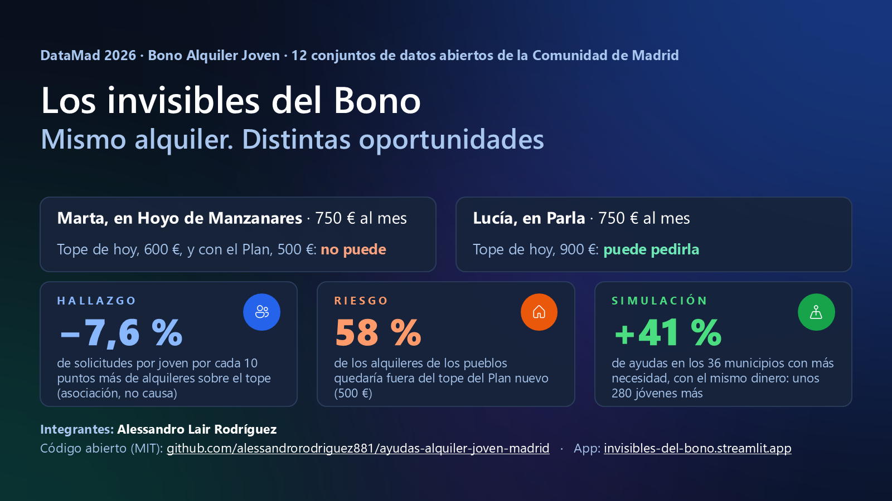
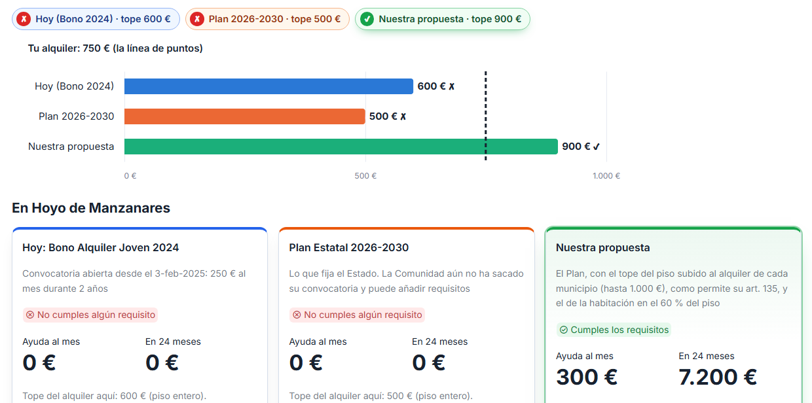
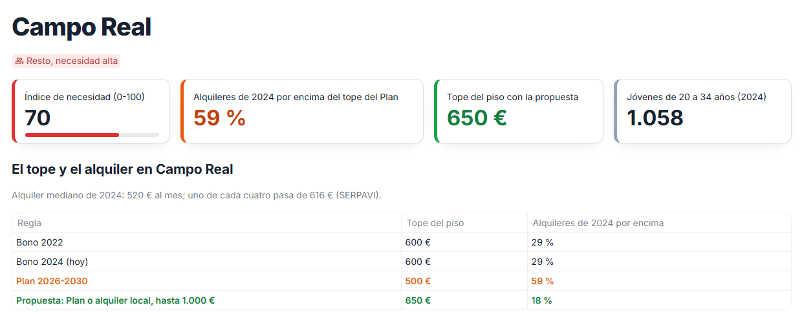
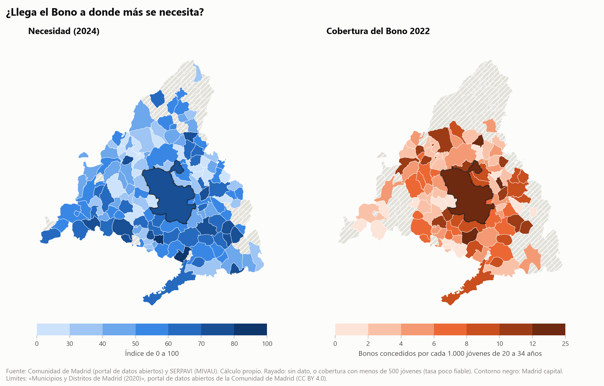
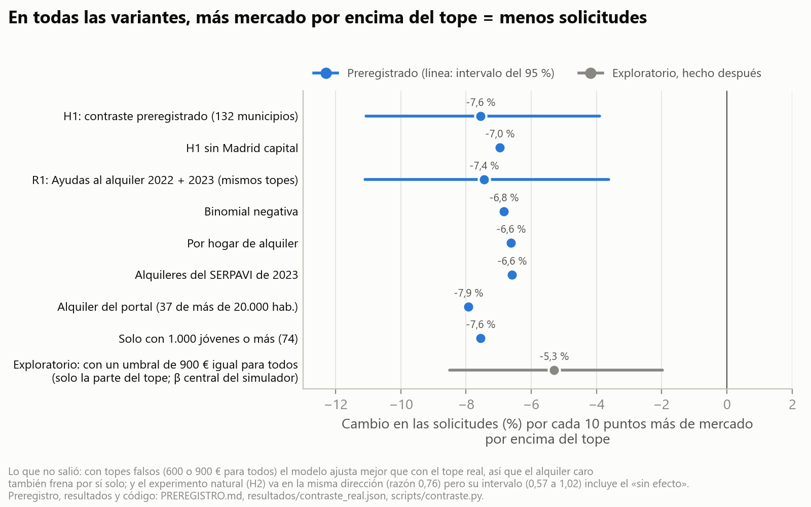
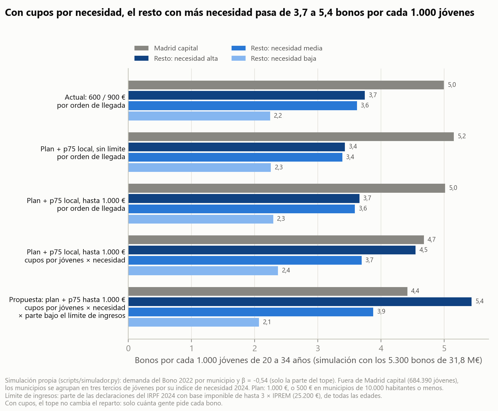
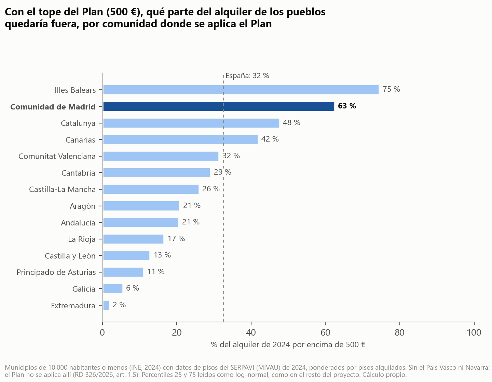

# 6 · Los invisibles del Bono

**DATAMAD 2026 · Proyecto 6** · Integrantes: Alessandro Lair Rodríguez

**¿Llegan las ayudas al alquiler a quien más las necesita?** El Bono Alquiler Joven da 250 € al mes durante 2 años, solo si el alquiler no pasa de 600 o 900 €. Los invisibles pagan más que el tope, no la piden y no salen ni entre los rechazados. Con datos abiertos de la Comunidad de Madrid medimos dónde pasa y simulamos cómo repartir el mismo dinero por necesidad.

## Lo principal

- **Hallazgo:** −7,6 % de solicitudes por joven por cada 10 puntos más de alquileres sobre el tope. Es una asociación, no una causa: contraste registrado antes de calcular, en 132 municipios (IC 95 %: −3,9 % a −11,1 %).
- **Riesgo:** con el tope del Plan 2026-2030 (500 €), quedaría fuera el 58 % de los alquileres de los pueblos (hoy, el 26 %).
- **Simulación:** con el mismo dinero (31,8 M€), llegaría un 41 % más de ayudas a los 36 municipios con más necesidad: unos 280 jóvenes más.

## La app: https://invisibles-del-bono.streamlit.app

**Para el joven, «¿Puedo pedirla?»:** Marta (Hoyo de Manzanares, 750 €) no puede hoy ni con el Plan; con la propuesta, sí: 300 € al mes.

**Para la Consejería, «Tu municipio»:** en Campo Real, con el tope del Plan quedaría fuera el 59 % de los alquileres; la propuesta sube el tope a 650 €.

## Los gráficos

**Necesidad y cobertura del Bono, municipio a municipio:**

**El −7,6 % y todas las pruebas de robustez:**

**La simulación: el mismo dinero repartido por necesidad:**

**El tope de 500 € del Plan, comunidad a comunidad:**

## Cómo lo hicimos

1. **Datos:** 12 conjuntos del portal de la Comunidad y el alquiler del SERPAVI, unidos por municipio con su código INE: 132 municipios con todos los datos, donde viven el 99,6 % de los jóvenes.
2. **Hipótesis escrita antes de calcular** (prerregistro del 2-nov, `PREREGISTRO.md` en el código): qué esperábamos y cómo lo íbamos a contrastar.
3. **Contraste:** −7,6 % de solicitudes por cada 10 puntos más de alquileres sobre el tope (IC 95 %: −3,9 % a −11,1 %). Con errores espaciales (Conley), de −10,9 % a −4,1 %. Lo que no salió también está contado (`ANALISIS.md`).
4. **Simulación:** el mismo dinero (31,8 M€) repartido por necesidad, con las reglas del Plan 2026-2030 (`scripts/simulador.py`).
5. **Para reutilizarlo:** la app, una base SQLite con su diccionario, una ficha DCAT-AP-ES, Smart Data Models y un servidor MCP para que una IA consulte las cifras con su fuente.
6. **Reproducible:** `python scripts/rehacer_todo.py --comprobar` rehace todos los resultados (unos 6 minutos), y GitHub lo comprueba en cada cambio.

## Enlaces

- **App:** https://invisibles-del-bono.streamlit.app
- **Código abierto (MIT), reproducible:** https://github.com/alessandrorodriguez881/ayudas-alquiler-joven-madrid

## En esta carpeta

- `Los_invisibles_del_Bono.pptx` y `Los_invisibles_del_Bono.pdf`: la presentación (3 diapositivas y la captura).
- `Los_invisibles_del_Bono_codigo.zip`: el código del repositorio.
- `Informe_Los_invisibles_del_Bono.pdf`: este README como informe en PDF, con todas las imágenes.
- `demo_app.mp4`: vídeo de 16 segundos de la app, con Marta y Campo Real.
- Las imágenes de este README: la portada, dos capturas de la app y cuatro gráficos del análisis (`resultados/figuras/` en el código).

## Datos abiertos utilizados

12 conjuntos del Portal de Datos Abiertos de la Comunidad de Madrid:

- [Bono Alquiler Joven 2022](https://datos.comunidad.madrid/dataset/spacm_bono_alquiler_joven_2022) (solicitudes)
- [Ayudas al alquiler para jóvenes](https://datos.comunidad.madrid/dataset/spacm_ayudas_alquiler_vivienda_jovenes_sectores_escasos_recursos) (2022 y 2023)
- [Población](https://datos.comunidad.madrid/dataset/poblacion_censada_por_edad_nacionalidad_y_sexo), [renta](https://datos.comunidad.madrid/dataset/irpf_indicador_renta), [IRPF](https://datos.comunidad.madrid/dataset/irpf_declaraciones_por_tramo) y [paro](https://datos.comunidad.madrid/dataset/paro_registrado_edad_municipio), por municipio
- [Censo 2021 (tenencia)](https://datos.comunidad.madrid/dataset/censo_2021_viviendas_familiares_por_tenencia)
- [Alquiler medio](https://datos.comunidad.madrid/dataset/alquiler_medio_mensual_viviendas_arrendadas_valor_catastral_municipios_mas_20000) e índices ([municipios](https://datos.comunidad.madrid/dataset/1934445), [distritos](https://datos.comunidad.madrid/dataset/1934430))
- [Límites](https://datos.comunidad.madrid/dataset/covid19_tia_muni_y_distritos) y [zonas](https://datos.comunidad.madrid/dataset/municipio_comunidad_madrid)

Además: [SERPAVI](https://www.mivau.gob.es/vivienda/alquila-bien-es-tu-derecho/serpavi) (Ministerio de Vivienda), el [Plan 2026-2030 en el BOE](https://www.boe.es/buscar/act.php?id=BOE-A-2026-8872), la [BDNS](https://www.infosubvenciones.es/bdnstrans/) y el INE ([IPC](https://www.ine.es/jaxiT3/Tabla.htm?t=50913) y población). Solo datos agregados, nada personal.

**Uso de IA:** está explicado en la sección «Uso de IA» del README del repositorio.
